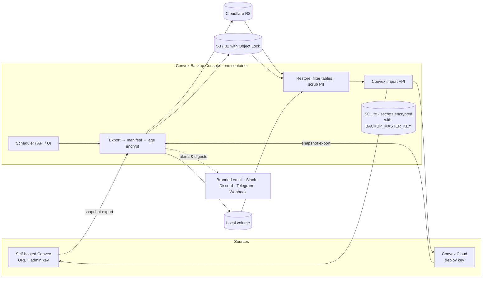

<div align="center">


# Convex Backup Console

**Backups for Convex you can actually restore.**

Scheduled, encrypted, off-site backups for **self-hosted Convex** and **Convex Cloud**, with
point-and-click restores, ransomware-proof storage and a console your whole team can use.
Plus a production-ready **Convex-on-Coolify** template to run the instances themselves.

[](CHANGELOG.md)
[](LICENSE)
[](docs/coolify.md)
[](https://convex.dev)
[](app)
[](testing/TESTING.md)

<a href="docs/coolify.md"></a>
<a href="https://render.com/deploy?repo=https://github.com/flyingwebie/convex-backup-console"></a>
<a href="docs/deploy.md#railway"></a>
<a href="docs/deploy.md#flyio"></a>
<a href="docs/deploy.md#docker"></a>

[Quick start](#-quick-start) · [Deploy anywhere](docs/deploy.md) · [Features](#-features) · [Screenshots](#-screenshots) · [How it works](#-how-it-works) · [Security](#-security) · [FAQ](#-faq)


</div>

---

## Why

Convex's snapshot export is great, but a backup strategy needs more than `npx convex export` in a cron job:

- **Off-site, versioned and immutable copies.** A backup on the same server, or one an attacker can delete, isn't a backup.
- **Encryption you control**, so a leaked bucket doesn't leak your users' data.
- **Restores that are rehearsed and safe:** into a staging copy, one table at a time, with personal data scrubbed.
- **Visibility:** know when a backup *didn't* happen, not just when one failed.
- **One place for every project and client**, with proper access control.

Convex Backup Console does all of that in a single container.

## ✨ Features

<table>
<tr>
<td width="50%"></td>
<td width="50%"></td>
</tr>
<tr>
<td colspan="2"></td>
</tr>
</table>

**Backups**
- 🔁 **Manual, cron or API-triggered** jobs, one instance → many destinations, including file storage.
- ☁️ **Self-hosted Convex** (URL + admin key) **and Convex Cloud** (deploy key; URL looked up automatically).
- 🔐 **age encryption** per workspace: decryptable offline with the standard `age` CLI.
- 🗄️ **S3-compatible destinations** (Cloudflare R2, AWS S3, Backblaze B2, Wasabi, MinIO, RustFS) and local volumes.
- 🧱 **S3 Object Lock:** backups can't be deleted or overwritten for N days, not even with stolen credentials.
- 🧹 **GFS retention** (keep-last + daily/weekly/monthly), **exports cleaned up** on the source automatically.
- 🧾 **Manifests:** tables, row counts, files and SHA-256 per backup, compared with the previous one.

**Restores**
- ↺ Into the **same or another instance**, in four modes (full, replace, append, empty-only).
- ✂️ **Partial restores:** only the tables you pick; everything else stays untouched.
- 🕶️ **Scrubbed staging copies:** fake emails, names and phones; redaction; hashing; consistent within a restore.
- ⬇️ **Download** any backup, decrypted or as the raw `.age` file.

**Operations**
- 📈 **Overview & storage dashboard:** health per instance, growth chart, monthly cost estimate.
- ✉️ **Branded emails** built with React Email: the workspace logo, accent colour and footer; templates you edit with variables and a live desktop/mobile preview (owners can write full HTML); and a **per-email recipients grid** (roles, specific members, outside addresses, "who did it"). Members can opt out, and alerts cover failed/partial backups, no recent backup, restores and daily/weekly digests.
- 🔔 **Chat alerts:** Slack, Discord, Telegram, webhook.
- 🩺 **Status URL** for Uptime Kuma, Better Stack and UptimeRobot (200 healthy / 503 not).
- 🚀 **REST API + GitHub Action:** back up right before `npx convex deploy`, with a per-workspace switch to turn API access off (the Action then skips).
- 🧭 **Guided product tour** on first sign-in (role-aware, replayable from the account menu) walks new users from connecting an instance to their first restore.
- 🗑️ **Trash & deletion policy:** restore deleted items for N days, with **separate toggles** for deleting their backup files from **remote** (S3/R2/B2) and **local** storage, each with its own delay in days.
- 📜 **Audit log** of every action, exportable as CSV.

**Teams**
- 🏢 **Workspaces**, e.g. one per client, each with its own logo, timezone, keys, alerts and members.
- 👥 **Roles:** Owner · Admin · Operator (run and download, no restore) · Viewer (read-only).
- 🔑 **Mandatory 2FA** (authenticator or passkey), **Google / GitHub / Microsoft** sign-in, invite-only accounts.
- 🛡️ Session management, sign out everywhere, admin 2FA reset, login rate limiting.

## 🚀 Quick start

### Coolify (recommended)

1. **+ New → Docker Compose Empty** → paste [`backup-console.coolify.yaml`](backup-console.coolify.yaml).
2. **Deploy**. Coolify generates the domain and the secrets.
3. Open the URL and follow the **setup wizard**: paste the one-time setup code from the service's **Logs**, create
   your admin account, add 2FA, create the first workspace (name, logo, timezone) and invite your team.
4. Create your encryption key in **Workspace → Settings**.

> **Save `SERVICE_PASSWORD_64_MASTERKEY` in your password manager.** It encrypts every stored key and secret.

Full guide, including OAuth setup: [`docs/coolify.md`](docs/coolify.md).

### Render, Railway, Fly.io

| | |
|---|---|
| [](https://render.com/deploy?repo=https://github.com/flyingwebie/convex-backup-console) | One click from [`render.yaml`](render.yaml): disk, health check and generated secrets (paid instance for the disk). |
| [](docs/deploy.md#railway) | Deploy the repo with root directory `/app`, add a volume at `/data` and two secrets. |
| **Fly.io** | `cd app && fly launch --copy-config` with the included [`fly.toml`](app/fly.toml) ([steps](docs/deploy.md#flyio)). |

**Not Vercel/Netlify:** the console needs an always-on process (for schedules) and a persistent disk (for its
database), which serverless platforms don't provide. See [`docs/deploy.md`](docs/deploy.md) for requirements and
every platform.

### Any Docker host

```bash
docker run -d --name convex-backups -p 3000:3000 \
  -v convex-backups:/data --read-only --tmpfs /tmp \
  -e PUBLIC_URL=https://backups.example.com \
  -e BACKUP_MASTER_KEY="$(openssl rand -base64 48)" \
  -e BETTER_AUTH_SECRET="$(openssl rand -base64 48)" \
  ghcr.io/flyingwebie/convex-backup-console:latest
docker logs convex-backups   # shows the setup code; then open your PUBLIC_URL
```

Put it behind HTTPS (Traefik, Caddy, Nginx or a Cloudflare Tunnel; see [`app/docker-compose.tunnel.yaml`](app/docker-compose.tunnel.yaml)).

### Then

| Step | Where |
|---|---|
| Add a **self-hosted** instance: API URL + `./generate_admin_key.sh` output | Instances → Add instance |
| Add a **Convex Cloud** deployment: a production or dev **deploy key** | Instances → Add instance → Convex Cloud ([guide](app/README.md#back-up-a-convex-cloud-deployment)) |
| Add a destination (R2, S3, B2…), optionally with Object Lock | Destinations |
| Create a job: schedule, retention, encryption | Jobs |
| Choose who gets which email, brand and edit them | Emails |
| Chat/webhook alerts | Notifications |

### Need a Convex instance first?

[`convex-instance.coolify.yaml`](convex-instance.coolify.yaml) deploys self-hosted Convex with **Postgres** and
**RustFS** (S3) storage on Coolify. The detailed walkthrough is in [`docs/convex-on-coolify.md`](docs/convex-on-coolify.md).

## 🖼️ Screenshots

| | |
|---|---|
|  **Overview:** health of every instance |  **Runs:** every backup and its copies |
|  **Contents:** tables, rows, changes since last backup |  **Restore:** pick target, mode, tables, scrubbing |
|  **Storage:** growth and monthly cost |  **Workspace settings:** branding, colour theme, defaults, policies |
|  **Destinations** with Object Lock |  **Members & roles** |
|  **Sign-in:** password, Google, GitHub, Microsoft, passkeys |  **Dark mode** |

## 🧠 How it works



1. A job asks the instance for a **snapshot export** through Convex's admin HTTP API, the same API `npx convex export` uses.
2. The console downloads it, records a **manifest** (tables, row counts, files, SHA-256) and **encrypts** it with the workspace's age key.
3. The archive is uploaded to every destination (with **Object Lock** where configured), then **retention** prunes old copies and the export is removed from the source.
4. A **restore** downloads and decrypts a copy, optionally **filters tables** or **scrubs** personal data, and runs Convex's import with your chosen mode.

### Recover without the console

```bash
age -d -i convex-backups-age-key.txt backup.zip.age > backup.zip   # key from Workspace → Settings
npx convex import --replace-all backup.zip                           # into any Convex deployment
```

## 🔐 Security

| Area | How |
|---|---|
| Sign-in | Invite-only. Password (12+ characters) or Google / GitHub / Microsoft; **second factor always required** (TOTP or passkey), including after social sign-in |
| Sessions | 24h, HttpOnly cookies, per-session factor tracking, list/revoke, sign out everywhere |
| Brute force | 5 sign-in / 2FA attempts per minute per IP (Cloudflare-aware) |
| Secrets at rest | Admin keys, deploy keys, S3 secrets, webhook URLs and age keys are encrypted with AES-256-GCM under `BACKUP_MASTER_KEY` |
| Backups at rest | age (X25519) per workspace; S3 Object Lock for immutability |
| Isolation | Every query scoped to the active workspace; role checks on every server function and API call |
| Container | Non-root, read-only filesystem, all capabilities dropped |
| Audit | Every change, backup, restore, download and key reveal is logged |

## 🤖 Back up before every deploy

```yaml
- uses: flyingwebie/convex-backup-console/.github/actions/convex-backup@main
  with:
    console-url: https://backups.example.com
    token: ${{ secrets.BACKUP_CONSOLE_TOKEN }}   # Workspace → Settings → API tokens
    job-id: <job-id>
- run: npx convex deploy
```

The REST API is documented in [`docs/github-action.md`](docs/github-action.md).

## 🆚 Compared with

| | This console | `npx convex export` + cron | Convex Cloud built-in backups |
|---|:-:|:-:|:-:|
| Self-hosted **and** Cloud | ✅ | ✅ | Cloud only |
| Off-site copies in your own storage | ✅ | DIY | ❌ |
| Encryption you hold the key to | ✅ | DIY | ❌ |
| Immutable (Object Lock) | ✅ | DIY | ❌ |
| Partial & scrubbed restores | ✅ | ❌ | ❌ |
| Alerts, digests, status URL | ✅ | DIY | — |
| Multi-project, roles, audit log | ✅ | ❌ | Per-team |

Convex Cloud's own backups are excellent, so keep them on. This adds independent, encrypted copies outside Convex.

## 📁 Repository

```
app/                            The console: TanStack Start · Better Auth · SQLite · React Email · shadcn/ui
backup-console.coolify.yaml     Coolify template: the console (deploy once)
render.yaml                     Render Blueprint (Deploy to Render button); app/railway.json, app/fly.toml for Railway / Fly.io
convex-instance.coolify.yaml    Coolify template: a self-hosted Convex instance (Postgres + RustFS), one per project
docs/                           Guides (Coolify, Convex on Coolify, GitHub Action), images
testing/                        Local Docker kit, Playwright e2e (45 + 8 onboarding checks), demo data
legacy/                         The old all-in-one instance compose, kept for existing deployments
.github/                        Image build (amd64 + arm64) and the convex-backup GitHub Action
```

## 🧪 Development & tests

```bash
cd app && pnpm install
BACKUP_MASTER_KEY=dev BETTER_AUTH_SECRET=dev-secret-at-least-32-characters-long \
SETUP_CODE=dev-setup pnpm dev   # then open http://localhost:3000/setup
pnpm test                       # unit tests
pnpm typecheck
```

The end-to-end suite runs two real Convex stacks (Postgres + RustFS), an S3 stand-in, Mailpit and a
webhook receiver locally. See [`testing/local/README.md`](testing/local/README.md) and the results in [`testing/TESTING.md`](testing/TESTING.md).

## ❓ FAQ

**Does it need Cloudflare?**
No. Cloudflare R2 is a great destination and Cloudflare Tunnel is an optional hardening layer, but neither is required.

**What happens if I lose the console?**
Your backups are plain (or age-encrypted) Convex snapshot zips in your own buckets. Decrypt them with the age key you saved and `npx convex import` them. The console is a convenience, not a dependency.

**Can I restore into Convex Cloud?**
Yes, with a deploy key for the target deployment. Restores into a *production* Cloud deployment show an extra warning.

**How big can a backup be?**
Exports are streamed to disk and uploaded in parts, so size is bounded by the container's free disk space, not memory.

**Is Microsoft sign-in work-accounts only?**
Set `MICROSOFT_TENANT_ID` to `common` (any account), `organizations` (work/school), or your tenant ID.

## 🗺️ Roadmap

- Scheduled restore drills with automatic verification
- Backing up Convex environment variables alongside data
- Self-registration of new instances from the Convex template
- One-click template in Coolify's built-in catalogue ([how to submit](docs/coolify.md#submit-them-to-coolifys-built-in-template-list))

## 🤝 Contributing

Issues and pull requests are welcome — start with [`CONTRIBUTING.md`](CONTRIBUTING.md).
Found a vulnerability? Please report it privately as described in [`SECURITY.md`](SECURITY.md).

## License

[MIT](LICENSE) © Davide Del Gatto · Flying Web Solutions. Not affiliated with Convex, Inc. or Coolify.
